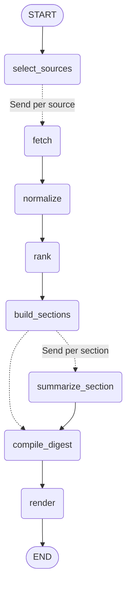

# news-agent

A **LangGraph** agent that turns 19 feeds — Y Combinator, Hacker News, OpenAI, Anthropic,
DeepMind, Mistral, Hugging Face, TechCrunch, The Verge, Ars, MIT TR, IEEE Spectrum, … —
into a single ranked, LLM-edited **AI news digest** with an Hacker-News-style HTML page,
a markdown digest, JSON and a subscribable RSS feed.

```
19 sources → 348 raw entries → 40 ranked articles → 4 LLM-edited sections → html/md/json/xml
```

## Quick start

```bash
uv sync
cp .env.example .env      # optional: add an LLM key (see below)
uv run news-agent         # same as `news-agent run`
```

Outputs land in `output/`:

| file                     | what it is                                        |
| ------------------------ | ------------------------------------------------- |
| `index.html`             | HN/YC-style feed page (also `index-YYYY-MM-DD.html`) |
| `digest.md`              | markdown digest                                   |
| `digest.json`            | machine-readable digest + full ranked list        |
| `feed.xml`               | RSS 2.0 of the digest items                       |

Without any API key the agent still runs and renders a **heuristic digest** (source
summaries instead of written TLDRs) — the LLM step is strictly optional.

## The graph

```
START ─► select_sources ─Send─► fetch            (one parallel branch per feed)
              fetch* ─► normalize ─► rank ─► build_sections
              build_sections ─Send─► summarize_section   (one LLM editor per section)
                        └─────────► compile_digest       (when the LLM is off)
              compile_digest ─► render ─► END
```

Mermaid (from `news-agent graph`):



### LangGraph pieces used

- **`StateGraph(AgentState)`** — one explicit, JSON-serializable state schema
  (`news_agent/state.py`) shared by every node.
- **Dynamic fan-out with `Send`** — two of them: one branch per feed at fetch time,
  one LLM editor per digest section. Edges are declared with
  `add_conditional_edges(..., [targets])` so LangGraph waits for all branches to join.
- **Reducers** (`Annotated[list, operator.add]`) on `raw_entries`, `fetch_log`,
  `errors`, `drafts` — this is what lets parallel branches merge without clobbering
  each other; single-writer channels (`articles`, `digest`) are plain lists/dicts.
- **Checkpointer** — a `MemorySaver` is compiled in; every run prints a `thread-id`
  and `--thread-id <id>` resumes that run.
- **Fault isolation** — a failing feed only writes to `errors`/`fetch_log`, a failing
  LLM call degrades that section to a heuristic draft. One bad upstream never kills
  the run.

### Nodes

| node                | responsibility                                                                 |
| ------------------- | ------------------------------------------------------------------------------ |
| `select_sources`    | load `sources.yaml`, apply `--only` / `--category` filters                     |
| `fetch`             | RSS/Atom parse or HTML scrape (parallel, retries/backoff)                      |
| `normalize`         | 48h window, keyword pre-filter, URL + near-duplicate title dedupe              |
| `rank`              | `weight*10 + recency decay + discussion bonus`, section-balanced top-N         |
| `build_sections`    | group into Labs & Product / Research / Community (YC+HN) / Industry            |
| `summarize_section` | structured-output LLM edit: headline, intro, TLDR, tags (parallel)             |
| `compile_digest`    | merge drafts by index, fall back per item, emit the digest                     |
| `render`            | write html / md / json / rss                                                   |

## CLI

```bash
uv run news-agent run                 # full run (default command)
uv run news-agent run --hours 24      # tighter time window
uv run news-agent run --top 60 --per-section 12
uv run news-agent run --only openai,anthropic-news,hacker-news
uv run news-agent run --category labs,research
uv run news-agent run --no-llm        # skip the LLM entirely
uv run news-agent run --provider deepseek --model deepseek-chat
uv run news-agent run --thread-id abc # resume a previous run
uv run news-agent sources             # list the registry
uv run news-agent graph               # print the graph as mermaid
```

## LLM configuration

Any OpenAI-compatible endpoint works. Pick the provider in `.env`:

```bash
NEWS_AGENT_PROVIDER=openrouter        # openrouter | deepseek | openai | custom
NEWS_AGENT_MODEL=deepseek/deepseek-v4.1-flash
OPENROUTER_API_KEY=...
```

`custom` uses `NEWS_AGENT_BASE_URL` + `NEWS_AGENT_API_KEY` (Ollama, vLLM, LiteLLM…).
If no key is present the run prints `LLM off (<reason>)` and continues.

Digest editing uses **structured output** (`SectionDraft` pydantic model) with a plain
JSON-schema retry as fallback; article references travel as integer indexes so the
model can only select real items — it can never invent a link.

## Adding a source

```yaml
# sources.yaml
- id: acme-labs
  name: Acme Labs Blog
  url: https://acme.dev/blog/rss.xml   # RSS/Atom ...
  type: rss                            # ... or `html` for a feedless index page
  category: labs                       # labs | research | community | media
  weight: 2.0                          # ranking prior
  max_items: 25
  keywords: [ai, llm, model]           # optional title filter (handy for HN)
```

For `type: html` you describe the listing with CSS selectors:

```yaml
- id: acme-news
  name: Acme News
  url: https://acme.dev/news
  type: html
  anchor: 'a[href^="/news/"]'          # link elements
  title: '[class*="__title"]'          # headline inside the link (fallback: link text)
  date: 'time'                         # optional date element
  tag: '[class*="__subject"]'          # optional topic label
  link_pattern: '^/news/[a-z0-9-]+/?$' # optional: keep only matching paths
  link_exclude: '/news/team'           # optional: drop matching paths
  user_agent: 'Mozilla/5.0 ...'        # optional: for Cloudflare-fronted hosts
```

`anthropic-news` and `anthropic-research` are live examples (Anthropic publishes no feed).

## Project layout

```
news_agent/
├── config.py     Settings + registry loading
├── models.py     SourceConfig / Article / SectionDraft (pydantic)
├── state.py      AgentState (LangGraph channels & reducers)
├── sources.py    RSS + HTML adapters, dedupe keys, retries
├── llm.py        provider factory + graceful degradation
├── nodes.py      node & router functions
├── graph.py      StateGraph assembly
├── render.py     html / markdown / json / rss writers
└── cli.py        argparse entry point
sources.yaml      source registry (19 feeds)
output/           generated artifacts (gitignored)
```